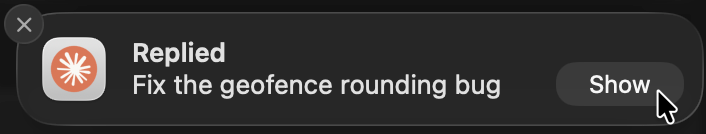

# claude-notify-resume

[](https://www.npmjs.com/package/@anaidenko/claude-notify-resume)
[](https://www.npmjs.com/package/@anaidenko/claude-notify-resume)
[](https://github.com/anaidenko/claude-notify-resume/actions/workflows/ci.yml)

Desktop notifications for [Claude Code](https://claude.com/claude-code) that
tell you **which conversation** replied — or is waiting on you — and take you
back into it.

```bash
npx @anaidenko/claude-notify-resume
```



Run several Claude sessions at once and the usual notification is useless: five
identical banners saying "Claude Code is done". Here, every banner is different
in two ways:

- **It names the chat.** The body is the conversation's own title, the one you
  see in `/resume`. It is not the folder or the branch.
- **Clicking it resumes that session**, in the terminal tab or VS Code window it
  was running in, even after you have closed it.

## Install

```bash
npx @anaidenko/claude-notify-resume
```

This adds the [anaidenko/claude-plugins](https://github.com/anaidenko/claude-plugins)
marketplace and installs the plugin. If the plugin is already installed, it
updates it instead. It needs Claude Code and Node.js. Restart Claude Code
afterwards: hooks are read at startup.

<details>
<summary>The same by hand</summary>

```bash
claude plugin marketplace add anaidenko/claude-plugins
claude plugin install claude-notify-resume@anaidenko
```

The npm package is only the installer. Either way, the plugin comes from the
marketplace.
</details>

**macOS.** Banners work out of the box. For click-to-resume, also run
`brew install terminal-notifier`. The first banner then offers an optional
setup, and copies its command to the clipboard. The setup gives banners the
Claude icon and needs the Xcode Command Line Tools. If its test banner does not
appear, open **System Settings → Notifications → Claude Code** and turn on
*Allow notifications*.

**Linux.** It needs `notify-send`, which desktop distros ship with libnotify
(`sudo apt install libnotify-bin` if yours does not). Banners have no click
action on Linux.

**Updates.** Run the installer again, or let them arrive on their own: `/plugin`
→ **Marketplaces** → `anaidenko` → enable auto-update.

## What you get notified about

| Status | Fires when |
| --- | --- |
| `Replied` | Claude finished responding: every turn, *not* "task complete" |
| `Permission needed` | A tool call is waiting for your approval |
| `Waiting for you` | Claude is idle, awaiting your next prompt |
| `Input needed` | An MCP server opened an elicitation form |
| `Background agent needs you` / `finished` | A background session wants input, or ended |

**In the VS Code extension, only `Replied` arrives.** The other statuses come
from Claude Code's `Notification` hook. The extension never fires that hook, and
Anthropic has closed the request as not planned
([anthropics/claude-code#55875](https://github.com/anthropics/claude-code/issues/55875)).
Terminal sessions get every status.

If a notifier is missing or something else goes wrong, the plugin stays silent.
A notification must never break your session.

## Where the session reopens

The plugin notes where the session is running when it sends the banner. A click
takes you back there:

- **VS Code extension:** the session's own tab, in the window it belongs to. If
  that window has closed, or VS Code has restarted, the session resumes in a
  terminal.
- **iTerm or Terminal:** the tab already running the session. If no tab is
  running it any more, a new window.

A CLI session in VS Code's integrated terminal, and VS Code Insiders, resume in
a regular terminal.

A resumed session is a *separate* Claude Code process that reads the same
transcript. Messages you send in the original window after that do not appear
in it. Resuming again picks them up.

## Configuration

Nothing needs configuring. To change something, create
`~/.claude/claude-notify-resume.conf` (see
[the example](claude-notify-resume.conf.example)):

```ini
# Statuses you would rather not be told about
MUTE=Replied,Waiting for you

# Force a terminal instead of the detected one: Terminal or iTerm
TERMINAL=iTerm
```

`Replied` is the usual one to mute: it fires on every reply, which is noise
while you are watching the chat. Every key also works as an environment
variable, such as `CLAUDE_NOTIFY_MUTE`, which overrides the file.

## Platform support

| Platform | Status |
| --- | --- |
| macOS | Supported, in daily use. Click-to-resume with `terminal-notifier`; optional Claude icon |
| Linux | Supported, tested on Debian 12 and Ubuntu 24.04. No click action |
| Windows | Not supported. [PRs welcome](CONTRIBUTING.md#where-help-is-most-useful) |

## Uninstall

```bash
claude plugin uninstall claude-notify-resume@anaidenko
rm -rf ~/.claude/claude-code-notify   # macOS: the plugin's state, and the icon app if you set it up
rm -rf ~/.local/state/claude-code-notify   # Linux: the plugin's state
```

Remove `~/.claude/claude-notify-resume.conf` too, if you created one.

## Contributing

Bash and the Node.js standard library, no dependencies. [CONTRIBUTING.md](CONTRIBUTING.md)
covers how it works, the tests and releasing. The most wanted contribution is a
tested Windows path.

## License

MIT
